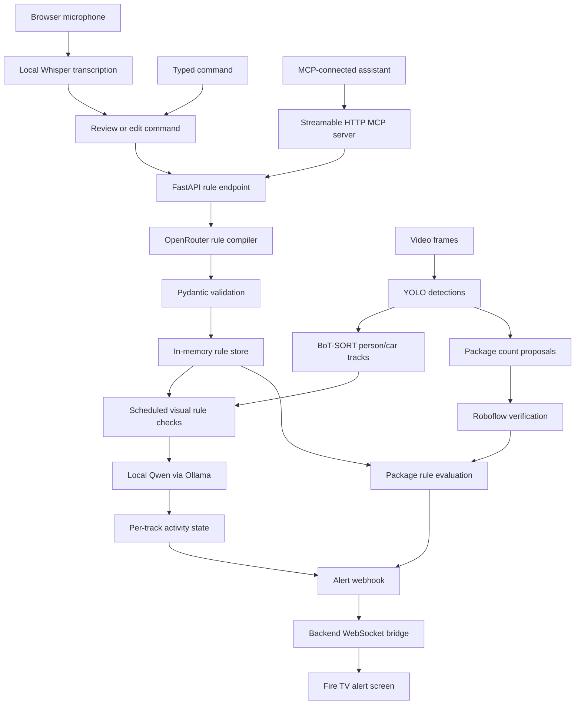

# Smart Rings

### Tell your home what to watch for.

Smart Rings is a smart-home monitoring prototype that turns natural-language instructions into camera-based automation rules and sends relevant alerts to a Fire TV application. A user can type a command, record it through the browser microphone, or ask an MCP-connected assistant to create an alert.

For example:

> “Alert me if a person is carrying a box.”

The system compiles that request into a structured rule, detects and tracks people in video, periodically checks their activity using a vision-language model, and sends an alert when a tracked person matches the condition.

The longer-term direction is a conversational home-event platform: understand what is happening now, retain a useful timeline, answer questions about the past, and automate actions based on events and time.

**Status:** working hackathon prototype with tested components. The default monitoring source is a replayed video. Persistent storage, complete live-camera monitoring, and general natural-language temporal queries are future work. This is not a production security system.

## Contents

- [What it does](#what-it-does)
- [Architecture and command flow](#architecture-and-command-flow)
- [Technology stack](#technology-stack)
- [Repository layout](#repository-layout)
- [Prerequisites](#prerequisites)
- [Installation and configuration](#installation-and-configuration)
- [Run the project](#run-the-project)
- [Fire TV application](#fire-tv-application)
- [MCP tools and connection](#mcp-tools-and-connection)
- [Ring integration](#ring-integration)
- [Rules and example commands](#rules-and-example-commands)
- [Data and lifecycle](#data-and-lifecycle)
- [Testing](#testing)
- [Troubleshooting](#troubleshooting)
- [Current limitations](#current-limitations)
- [Future scope and open-source roadmap](#future-scope-and-open-source-roadmap)
- [Contributing and licensing](#contributing-and-licensing)

## What it does

| Capability | Current implementation |
| --- | --- |
| Natural-language monitoring rules | OpenRouter compiles a submitted command into validated JSON. |
| Browser voice commands | Local Whisper transcription produces editable text that follows the same rule-creation flow. |
| Object detection | A local unified YOLO model detects packages, people, and cars. |
| Object tracking | BoT-SORT associates person/car detections across frames using temporary tracking IDs. |
| Visual verification | Qwen checks a crop against the generated question, such as whether someone is carrying a box. |
| Package monitoring | Local count proposals are verified using a Roboflow workflow in the hybrid pipeline. |
| Alert delivery | An outgoing HTTP webhook is normalized by the backend and broadcast over WebSocket to Fire TV. |
| Dashboard | Create, pause, resume, and remove rules; view status and recent alerts. |
| MCP | Six tools exposed through Streamable HTTP, with optional legacy stdio. |
| Ring access | Device APIs and a separate WHEP/WebRTC video-preview integration. |
| History and deadlines | Basic process-local event filtering and deadline records; not a persistent temporal database. |

The Alexa dashboard is a **simulated Alexa-style browser experience**. It does not register an Amazon Echo skill, connect an Echo device, or listen continuously for a wake word.

## Architecture and command flow



### 1. Compile the intent

The backend sends the original command to OpenRouter. The default compiler model is `openai/gpt-4o-mini`, configurable through `OPENROUTER_MODEL`. It generates the rule ID, source, visual question or numeric condition, and alert configuration within the supported schema.

The system prompt contains examples and capabilities, but the application does **not** select a canned rule from a prompt lookup table. Empty or invalid output receives one repair attempt through the model; a second failure returns an error. The hardcoded rules in `src/evaluator/rules.py` are fixtures used by evaluator tests, not automatically armed monitoring rules.

The REST endpoint also accepts an explicit rule object for programmatic/manual use. That explicit path bypasses natural-language compilation.

### 2. Detect, track, and verify

YOLO provides object classes, confidence scores, and bounding boxes. It does not determine a person's identity or directly provide a “carrying a box” label. BoT-SORT supplies temporary tracking IDs, and Qwen evaluates the generated visual question against an object crop.

Each visible track/rule pair is checked periodically. The default minimum recheck interval is two seconds after a completed check; actual timing also depends on inference speed and the number of candidates. Only one visual inference is admitted at a time, and candidates are scheduled by their last check time rather than permanently favouring the first person in a frame.

For ordinary visual rules:

- An initial YES can trigger an alert.
- Continuing YES results for the same activity do not repeatedly alert.
- A NO re-arms that track; a later YES can trigger another alert after its cooldown.
- A second track has independent activity state and cooldown.
- An error or unclear answer is unknown; it does not falsely re-arm an episode.
- `once_ever` retains a rule-wide one-alert limit across video rewinds.

Tracking IDs describe continuous appearances, not permanent identities. Detection gaps and overlaps can split a person into different tracks or switch IDs.

### 3. Deliver the event

A matched event is sent to `ALERT_WEBHOOK_URL`. The backend's `/webhook/alert` route normalizes it and broadcasts it through `/ws/alerts`. The TV app displays the current alert and a bounded recent-event list. A successful broadcast can have zero recipients if no TV is connected.

### Where processing happens

- **OpenRouter:** submitted command text for rule compilation. This may incur provider charges.
- **Local Whisper:** browser recordings sent to the backend for transcription; the application does not intentionally persist those recordings.
- **Local Ollama/Qwen:** person/car image crops for visual reasoning.
- **Roboflow:** selected frames for cloud package verification in hybrid monitoring.
- **FastAPI:** rules, process-local history, status, webhook ingestion, and WebSocket delivery.

The complete pipeline is therefore a mix of local and cloud processing, not a fully offline system.

## Technology stack

| Tool | Role |
| --- | --- |
| Python 3.11 | Backend, monitoring, model orchestration, and MCP server. |
| FastAPI and Uvicorn | REST endpoints, WebSockets, and service lifecycle. |
| Streamlit | Browser-based Alexa dashboard and microphone recording. |
| OpenRouter / GPT-4o-mini | Natural-language-to-rule compilation with structured output. |
| Pydantic | Rule schema generation and validation. |
| Ultralytics YOLO | Unified package/person/car detection. |
| BoT-SORT and LAP | Object association across video frames. |
| OpenCV and NumPy | Frame capture, bounding boxes, crops, and image processing. |
| Ollama / Qwen2.5-VL | Local visual reasoning; default `qwen2.5vl:3b`. |
| faster-whisper / CTranslate2 | Local speech transcription using CPU int8 inference. |
| Roboflow Inference and Inference SDK | Detector fallback and hosted package verification workflow. |
| Official MCP Python SDK | Streamable HTTP tools; protocol `2025-11-25`. |
| HTTPX | HTTP clients for model services and backend adapters. |
| aiortc | Ring WHEP/WebRTC receiving. |
| React Native, React, TypeScript | TV application. |
| Amazon Vega/Kepler SDK | Build and run the TV app on Vega OS. |
| Metro and Hermes | TV JavaScript bundling and runtime artifacts. |
| pytest, Jest, React Native Testing Library | Backend, transport, UI, and behaviour checks. |
| ESLint, Prettier, TypeScript compiler | TV source quality and type checks. |
| Docker and Docker Compose | Existing optional backend/dashboard deployment configuration. |

The core implementation does not require AWS Bedrock or another AWS runtime service. The TV project is currently Vega-specific; it is not a general Android TV/Apple TV application.

## Repository layout

```text
smart_rings/
├── README.md                         # Main setup, scope, and roadmap
├── smart_ring_be/
│   ├── app.py                        # Desktop/demo launcher
│   ├── requirements.txt
│   ├── Dockerfile
│   ├── docker-compose.yml
│   ├── .streamlit/config.toml         # Dashboard theme
│   ├── mcp/server.py                 # Streamable HTTP MCP server
│   ├── scripts/                      # Voice setup, training, prompt/MCP checks
│   ├── docs/                         # MCP connection guide and research notes
│   ├── tests/
│   ├── vids/theft.mp4                 # Default replay input, if distributed
│   ├── models/                       # Local weights; excluded by .gitignore
│   └── src/
│       ├── backend/                  # FastAPI app and routes
│       ├── evaluator/                # Compiler, schema, and package evaluator
│       ├── integrations/ring/        # Ring API and video receiving
│       ├── notifications/            # Outgoing alert webhook
│       ├── services/speech.py        # Local Whisper service
│       ├── storage/                  # In-memory rules and event timeline
│       ├── ui/                       # Dashboard and backend client
│       └── vision/                   # Detection, tracking, and visual checks
└── firetv-app/
    ├── src/App.tsx                    # TV interface and WebSocket client
    ├── test/
    ├── package.json
    └── manifest.toml                 # Vega package metadata
```

Some older research/prototype modules and placeholder directories are not part of the main runtime. The flows described above refer to the mounted backend, current dashboard, and monitoring loops.

## Prerequisites

- Python **3.11** and a virtual environment.
- A machine with enough memory for YOLO, Qwen, and Whisper together. CPU execution is supported by the voice service; visual inference throughput depends on available hardware.
- [Ollama](https://ollama.com/download), running locally, with the [Qwen2.5-VL model](https://ollama.com/library/qwen2.5vl).
- An OpenRouter API key with access to the configured compiler model.
- A Roboflow API key and access to the workflow used by the hybrid package pipeline.
- Network access for provider requests and initial dependency/model downloads.
- For TV development: Node.js **20 or newer**, npm, the Amazon Vega SDK/Kepler tooling, and a supported Vega device or simulator.
- For Ring preview: an authorized Ring developer device/simulator/API environment and a valid access token.

Local speech and detection weights are not installed just by installing Python packages.

## Installation and configuration

### 1. Install the Python environment

After cloning or downloading this repository, run from the repository root:

```bash
cd smart_ring_be
python3.11 -m venv .venv
source .venv/bin/activate
python -m pip install --upgrade pip
python -m pip install -r requirements.txt
```

The commands in this guide assume macOS/Linux shells. On Windows, use the equivalent virtual-environment activation and executable paths; the desktop/TV tooling may need additional platform-specific setup.

Avoid installing several OpenCV distributions on top of each other. The inference dependencies already provide `cv2`; consult `requirements.txt` before adding another OpenCV wheel.

### 2. Create `smart_ring_be/.env`

Create this file locally using your own credentials. All example credentials below are placeholders:

```dotenv
OPENROUTER_API_KEY=replace_with_your_own_key
OPENROUTER_MODEL=openai/gpt-4o-mini
ROBOFLOW_API_KEY=replace_with_your_own_key

OLLAMA_URL=http://127.0.0.1:11434/api/generate
OLLAMA_MODEL=qwen2.5vl:3b

FASTAPI_BASE_URL=http://127.0.0.1:8000
ALERT_WEBHOOK_URL=http://127.0.0.1:8000/webhook/alert
INCLUDE_FRAME_IN_WEBHOOK=true
START_HEADLESS_LOOP=true
VISUAL_RECHECK_SECONDS=2

MCP_HOST=127.0.0.1
MCP_PORT=8002
MCP_BACKEND_URL=http://127.0.0.1:8000
```

Optional settings:

| Variable | Purpose |
| --- | --- |
| `WHISPER_MODEL_PATH` | Absolute path to a complete local faster-whisper model directory. |
| `RING_ACCESS_TOKEN` | Authorized token for Ring device and video requests. |
| `RING_DEVICE_ID` | Default Ring device; discovery is attempted when omitted. |
| `RING_API_BASE_URL` | API base URL for your authorized Ring environment. |
| `ALERT_WEBHOOK_SECRET` | Adds secret headers on outgoing webhooks; current ingestion does not validate them. |
| `MCP_AUTH_TOKEN` | Reviewer bearer token for a protected MCP listener. |
| `MCP_PUBLIC_URL` | Exact HTTPS MCP URL when deliberately configuring remote access. |
| `MCP_ALLOWED_ORIGINS` | Additional explicitly allowed browser origins, comma-separated. |

Do not commit `.env`. Set shell environment variables before starting a process when overriding `.env` values. Restart the relevant process after changing its environment configuration.

### 3. Prepare models and video

Download the local visual model:

```bash
ollama pull qwen2.5vl:3b
```

Start Ollama if it is not already running through its desktop app/service:

```bash
ollama serve
```

The preferred unified detector must be available at:

```text
smart_ring_be/models/unified_detector/weights/best.pt
```

It must use the expected classes: `package`, `person`, and `car`. Without it, the monitor attempts a Roboflow detector fallback; do not assume that fallback supplies the same person/vehicle coverage.

The default headless video input is:

```text
smart_ring_be/vids/theft.mp4
```

**Fresh-clone asset requirement:** model weights are excluded by the existing `.gitignore`. Obtain compatible weights and authorized footage from the maintainers or prepare them yourself. This repository currently does not specify a public download URL for the trained unified detector. A reproducible release must distribute permitted assets or provide their retrieval instructions; the files are not created automatically by `pip install`.

Training helpers are in `scripts/create_unified_dataset.py` and `scripts/train_unified.py`. These are development scripts, not a one-command portable installer: update dataset paths, supply licensed datasets, and adjust the hardcoded `mps` training device for your hardware before using them.

For voice input, either reuse a complete local cached Whisper model or download the compact English model:

```bash
python scripts/setup_voice.py
```

This writes the model into `models/whisper-base.en`. The service can also reuse supported local Hugging Face cache directories, including a complete faster-whisper large-v3-turbo cache. It never downloads model weights during a transcription API request. A host model cache is not automatically available inside a container.

## Run the project

### Recommended: separate processes

This makes it clear which backend, dashboard, and MCP server you are running. Use a separate terminal for each command, starting from `smart_ring_be` and activating `.venv` in each terminal.

**Terminal 1 — backend and headless monitoring**

```bash
START_HEADLESS_LOOP=true python -m uvicorn src.backend.main:app --host 127.0.0.1 --port 8000
```

With valid assets and model-service access, the background engine repeatedly processes `vids/theft.mp4`. To start the API without monitoring, set `START_HEADLESS_LOOP=false`, then start monitoring later from the dashboard or loop API.

**Terminal 2 — Alexa dashboard**

```bash
FASTAPI_BASE_URL=http://127.0.0.1:8000 python -m streamlit run src/ui/dashboard.py --server.port 8501
```

Open [http://localhost:8501](http://localhost:8501).

1. Type a command or select a suggestion.
2. Alternatively, expand **Use your voice**, record, and stop.
3. Review or edit the transcript.
4. Select **Create alert**.
5. Confirm the rule appears in the watchlist and monitoring is running.
6. Use Pause/Resume or Remove to manage individual rules.

Recording alone does not create an alert. Microphone recording needs a localhost/HTTPS page and browser microphone permission. Speech is transcribed on the backend; a remote backend therefore receives the recording.

**Terminal 3 — MCP server, if needed**

```bash
MCP_BACKEND_URL=http://127.0.0.1:8000 python mcp/server.py
```

The dashboard calls the backend directly and does not require this separate MCP process. Start MCP when connecting an external assistant/client.

| Service | Default local address |
| --- | --- |
| Dashboard | `http://localhost:8501` |
| Backend and OpenAPI docs | `http://127.0.0.1:8000/docs` |
| Automation status | `http://127.0.0.1:8000/api/v1/automations/status` |
| Voice readiness | `http://127.0.0.1:8000/api/v1/voice/status` |
| MCP endpoint | `http://127.0.0.1:8002/mcp` |
| MCP health | `http://127.0.0.1:8002/health` |
| TV WebSocket | `ws://YOUR_BACKEND_LAN_IP:8000/ws/alerts` |

### Alternative: desktop video window

From `smart_ring_be`:

```bash
START_HEADLESS_LOOP=false python app.py --mode hybrid --video vids/theft.mp4 --no-tv
```

This opens the OpenCV monitor, attempts to start/reuse a backend, and opens the dashboard. Omit `--no-tv` only when your Vega tooling/device is configured. Use `--no-ui` to avoid automatically launching the dashboard. Press **q** or **Esc** in the video window to exit.

Important desktop-launcher behaviour:

- It reuses any service already listening on ports 8000/8501; a listener is not proof that the latest source is running.
- It clears rules at startup and shutdown.
- Run only one monitoring path at a time. Do not combine the desktop video loop with an already-running headless loop unintentionally.
- Dashboard loop status describes the headless engine, not the separate desktop window.
- Use `hybrid` for the combined visual/package rule workflow. The `model` and `workflow` modes are diagnostic count-processing paths and do not provide the same full visual-rule flow.

### Run with Docker Compose

The project includes a Dockerfile and Docker Compose setup for the FastAPI backend and Streamlit command dashboard. You can use this instead of starting those two services manually. Run the commands below from the repository root unless noted otherwise.

#### 1. Prepare credentials and local assets

Install Docker with Docker Compose support and start the Docker engine. Create `smart_ring_be/.env` using your own credentials as described above.

The current Dockerfile copies local assets during the build. Before building, provide:

- `smart_ring_be/vids/theft.mp4`: your authorized test footage, used by the default headless monitor.
- `smart_ring_be/models/`: the model directory; place the unified detector at `models/best.pt` for local package/person/car detection.
- `smart_ring_be/yolo11s-seg.pt`: the additional weights file explicitly copied by the current Dockerfile.

These local assets are excluded from Git. A fresh clone alone is therefore not enough to build and run the current image. See the model and footage preparation instructions above. For voice input, prepare a complete faster-whisper model in `smart_ring_be/models/whisper-base.en`; a model cached only on the host is not automatically visible inside the container.

#### 2. Start Ollama on the host

```bash
ollama pull qwen2.5vl:3b
ollama serve
```

If Ollama is already running, use that instance. Compose directs the backend to `http://host.docker.internal:11434/api/generate`. Ensure the host Ollama service accepts connections from Docker; a service listening only on host loopback may need its listen address adjusted for your Docker environment.

Use container-visible paths in `.env`. For example, if you explicitly configure the voice model:

```dotenv
WHISPER_MODEL_PATH=/app/models/whisper-base.en
ALERT_WEBHOOK_URL=http://127.0.0.1:8000/webhook/alert
```

The webhook address above is correct for an alert sent by the backend to its own HTTP endpoint inside the same container. Compose supplies the dashboard with `FASTAPI_BASE_URL=http://backend:8000` so it can reach the backend across the Compose network.

#### 3. Build and start

Stop any manually started backend/dashboard that already occupies ports 8000 or 8501, then run:

```bash
cd smart_ring_be
docker compose up -d --build
```

| Compose service | Container | Address / role |
| --- | --- | --- |
| `backend` | `smart_ring_backend` | Backend at `http://localhost:8000`; API docs at `/docs`; headless monitoring enabled. |
| `alexa` | `smart_ring_alexa` | Streamlit command dashboard at `http://localhost:8501`; starts after the backend health check succeeds. |

The Compose service name `alexa` refers to the project's browser command interface. It does not deploy an Alexa skill. The current dashboard command forces a dark theme.

#### 4. Inspect, update, and stop

From `smart_ring_be`:

```bash
# Inspect service status and logs
docker compose ps
docker compose logs --tail=100 backend alexa

# Follow backend output during a monitoring session
docker compose logs -f backend

# Rebuild and recreate after source or dependency changes
docker compose up -d --build --force-recreate

# Stop and remove the service containers
docker compose down
```

Application source is copied into the image rather than mounted live. Restarting an old container does not apply host source changes; rebuild and recreate it. The backend mounts `./models` at `/app/models`, but rules, event history, and deadlines are still held in process memory and are lost when the backend process restarts. Docker does not add database persistence.

#### MCP and Fire TV with Docker

The current Compose file does **not** start MCP, Ollama, or the Fire TV application. With the backend container running, start MCP separately on the host using the Python environment prepared above:

```bash
cd smart_ring_be
source .venv/bin/activate
MCP_BACKEND_URL=http://127.0.0.1:8000 python mcp/server.py
```

If already inside `smart_ring_be`, omit the `cd` command. The MCP endpoint is `http://127.0.0.1:8002/mcp`.

Build and launch the Fire TV application separately using the next section. Configure its WebSocket URL as `ws://YOUR_DOCKER_HOST_LAN_IP:8000/ws/alerts`; `localhost` on a physical TV refers to the TV itself.


## Fire TV application

The TV app receives alerts; it does not run YOLO, Whisper, or Qwen itself.

### Configure and build

From the repository root:

```bash
cd firetv-app
npm install
```

Configure `DEFAULT_WS_URL` in `src/App.tsx` to point to your backend:

```text
ws://YOUR_BACKEND_LAN_IP:8000/ws/alerts
```

The checked-in default is machine-specific. `localhost` on a physical TV refers to the TV, not your development computer. The backend must listen on a reachable interface for a physical-device demo; choose the appropriate host binding and network access for your environment. Build again after changing the endpoint.

With Vega/Kepler tooling installed:

```bash
npm run build:debug
vega device list
vega device install-app --device Simulator --dir . --buildType Debug
vega device launch-app --device Simulator --dir .
```

For physical hardware, replace `Simulator` with the connected device serial. Match the built architecture to the target. Debug `.vpkg` files are produced under `build/<architecture>-debug/`.

Building a package does not install it. Installing it does not start the backend. Launch the app and check backend `/api/v1/fire-tv/status` to confirm an actual WebSocket connection.

### Test the delivery bridge

With the backend and TV app running, this sends an intentional **test notification**:

```bash
curl -X POST http://127.0.0.1:8000/webhook/alert \
  -H 'Content-Type: application/json' \
  -d '{"event":"TEST_ALERT","rule_id":"demo_test","alert":"Test alert from Smart Rings"}'
```

This tests webhook-to-TV delivery only. It does not establish camera detection or rule accuracy. Snapshot rendering is supported, but current rule-alert paths do not attach a frame automatically.

## MCP tools and connection

Smart Rings uses the official MCP SDK with Streamable HTTP at `/mcp`, supporting protocol `2025-11-25`.

| Tool | Purpose |
| --- | --- |
| `create_automation(request)` | Compile a natural-language monitoring instruction and register its rule. |
| `list_active_rules()` | Return configured rule entries; entries include enabled status. |
| `remove_rule(rule_id)` | Remove one rule. |
| `clear_all_rules()` | Remove all rules. |
| `query_history(start_time, end_time, object_type)` | Filter events currently available in RAM. |
| `set_deadline_alert(expected_event, deadline_time, alert_message)` | Register a basic missed-event deadline. |

Local client settings:

```text
Transport: Streamable HTTP
URL: http://127.0.0.1:8002/mcp
```

Optional read-only connection check:

```bash
python scripts/check_mcp.py --url http://127.0.0.1:8002/mcp
```

Optional legacy transport:

```bash
python mcp/server.py --transport stdio
```

The server can be run by reviewers on their own machine; they do not need access to your localhost. A genuinely remote connection requires a reachable HTTPS deployment and appropriate authentication. Public/non-loopback configurations require `MCP_AUTH_TOKEN`; the implementation provides a manually configured bearer token, not an OAuth authorization server. See the [MCP connection guide](smart_ring_be/docs/mcp-connection.md) for configuration and client-header details.

An MCP client/assistant chooses the tool. The Streamlit dashboard does not currently route arbitrary history/deadline sentences into MCP tools automatically.

## Ring integration

The backend contains Ring device discovery, status/capability requests, event-history access, and WHEP/WebRTC video receiving. Configure an authorized `RING_ACCESS_TOKEN`, optionally `RING_DEVICE_ID`, and the base URL appropriate to your Ring developer environment.

Example local API calls:

```bash
curl http://127.0.0.1:8000/api/v1/devices
curl -X POST http://127.0.0.1:8000/api/v1/streams/start \
  -H 'Content-Type: application/json' \
  -d '{"device_id":"YOUR_DEVICE_ID"}'
```

Open `http://127.0.0.1:8000/api/v1/streams/preview` after starting a stream. Stop it using `POST /api/v1/streams/stop`.

**Current boundary:** Ring preview frames are not connected to the automation engine's frame source. Starting a Ring stream does not replace the replayed MP4 used for rule monitoring. Connecting those paths is a roadmap item. A local replay is not proof of a working Ring device/simulator integration.

## Rules and example commands

### Visual rules

- “Alert me if a person is carrying a box.”
- “Alert me if someone wearing black pants is seen.”
- “Alert me if a person wearing a gray hoodie is seen.”
- “Alert if a white car is detected.”
- “Alert if a car with license plate 7ABC123 is detected.”

Example visual rule shape:

```json
{
  "id": "person_carrying_box",
  "source": "person",
  "vlm_query": "Is this person holding or carrying a package or box? Answer YES or NO.",
  "expected_answer": "YES",
  "alert": {"fire": "every_time", "cooldown_seconds": 5.0}
}
```

This is an illustrative generated shape, not a rule automatically loaded at startup. `expected_answer: YES` describes a match; it does not force Qwen's answer to YES.

### Package rules

- “Alert me whenever a package disappears.”
- “Alert me if package count drops below 2.”
- “Alert me when two or more packages arrive.”
- “Alert if package count decreases.”

Package rules express a derivation (`identity` or `delta`), aggregation, comparison, and alert mode. They evaluate against verified observations. A count decrease is evidence of removal, not proof of theft or who caused it.

### HTTP rule creation

```bash
curl -X POST http://127.0.0.1:8000/api/v1/automations/rules \
  -H 'Content-Type: application/json' \
  -d '{"prompt":"Alert me if a person is carrying a box"}'
```

Useful endpoints:

| Endpoint | Behaviour |
| --- | --- |
| `GET /api/v1/automations/rules` | Configured rule entries. |
| `PATCH /api/v1/automations/rules/{id}/toggle` | Set `{"enabled": true}` or `false`. |
| `DELETE /api/v1/automations/rules/{id}` | Remove one rule. |
| `POST /api/v1/automations/loop/start` | Start headless replay monitoring. |
| `POST /api/v1/automations/loop/stop` | Stop headless monitoring. |
| `GET /api/v1/automations/history` | Query current in-memory events. |
| `POST /api/v1/automations/deadline` | Register a deadline. |
| `POST /api/v1/voice/transcribe` | Transcribe WAV bytes without creating a rule. |

## Data and lifecycle

The current event timeline is an **in-memory list**, not a database.

| Data | What the current code keeps |
| --- | --- |
| Timeline metadata | Event ID, wall-clock epoch timestamp, human-readable date/time, event type, and details. |
| Package observations | Verified counts and video timestamps; evaluation history is scoped to a playback cycle. |
| Person/car appearances | Temporary track ID, source class, and video timestamp. |
| Visual alerts | Rule ID, track ID, video timestamp, alert text, and Qwen response. |
| Runtime state | Last seen/check times, pending inference, match state, episode state, and cooldowns. |
| Rules | JSON rule, original prompt, enabled status, and creation time. |
| TV UI | Current alert and up to 50 recent received events in application memory. |

Wall-clock event time and video time are different. Replaying the same clip starts its video time over again. Current human-readable timestamps follow the process's timezone; timezone-aware temporal modelling is planned.

- Fully stopping/restarting a process loses the data held in that process's RAM.
- Pausing headless monitoring leaves the process's rules and recorded timeline in memory.
- Tracking state resets on playback rewind; stale callbacks are invalidated.
- The desktop launcher's explicit startup/shutdown rule-clearing behaviour is separate from pausing monitoring.
- Different processes do not share a timeline automatically. A desktop monitor's history is not the backend process's history.
- The live loops do not persist every frame's bounding boxes, confidence values, or counts.
- `src/storage/store.py` has a JSON observation helper, but current monitoring loops do not use it as durable storage.

The existing history filter and deadline mechanism are limited to this temporary event store. General date-range questions, reliable “did a delivery happen between these times?” reasoning, and restart-safe scheduling are not yet implemented.

## Testing

From `smart_ring_be`, install the development test runner if necessary:

```bash
python -m pip install pytest
python -m pytest \
  tests/test_rule_compilation.py tests/test_rule_evaluator.py \
  tests/test_visual_monitor.py tests/test_mcp_http.py \
  tests/test_voice.py tests/test_dashboard.py \
  tests/test_history_tools.py tests/test_webhook.py \
  tests/test_fire_tv.py tests/test_ring_integration.py -q
```

These selected tests cover compiler validation/retries, tracking and activity episodes, HTTP MCP initialization/discovery/tool forwarding, voice boundaries, dashboard interactions, package evaluation, and alert delivery adapters. Model/provider responses are mocked where appropriate. Passing these tests is not a measurement of real-world detection accuracy.

Do not blindly collect all files under `tests/`: `test_package_tracking.py` is an interactive model/video script with work at import time. It should eventually be moved out of unit-test discovery.

Opt-in real provider checks:

```bash
python scripts/check_requested_prompts.py --live
```

This sends requests to OpenRouter and can spend provider credits. It tests compilation and selected synthetic count transitions, not the complete camera-to-TV pipeline. It does not arm monitoring rules.

From `firetv-app`:

```bash
npm test -- --runInBand --watchman=false
npx tsc --noEmit
npx eslint src/App.tsx test/App.spec.tsx
npm run build:debug
```

A full demo check should separately verify microphone capture, actual Qwen answers, package verification, multiple people, rule creation, and a visible alert on a device/simulator. Use footage representing both matching and non-matching cases.

## Troubleshooting

| Symptom | Check |
| --- | --- |
| Old dashboard after editing source | The launcher reuses existing listeners. Confirm the URL and running process/image, not just the files you edited. |
| Backend unavailable | Start FastAPI; match `FASTAPI_BASE_URL`/`MCP_BACKEND_URL` to the actual port. |
| Rule saved but nothing happens | Check headless monitoring status, assets, detected classes, Ollama, and whether the selected footage contains the requested activity. |
| Empty/invalid rule generation | Check OpenRouter model access/credits/connectivity and compiler logs. There is one repair attempt and no canned-rule fallback. |
| Voice unavailable | Inspect `/api/v1/voice/status`; install requirements and provide a complete local model accessible to the backend. |
| Microphone cannot record | Use localhost or HTTPS and grant the browser microphone permission. |
| No Fire TV alert | Check the app's WebSocket address, backend binding, `ALERT_WEBHOOK_URL`, and `/api/v1/fire-tv/status`. A TV cannot use the computer's localhost. |
| A carried box is not recognised | Inspect the crop and model answer. Occlusion, blur, framing, and short actions can prevent a match. |
| Duplicate person alerts | Track continuity may have been lost or the visual result may have toggled between NO and YES. |
| Qwen cannot connect | Start Ollama, pull the configured model, and verify `OLLAMA_URL` for the host/container environment. |
| MCP connects but a tool fails | The MCP listener and backend are separate. Confirm the backend address and required services are running. |
| `GET /mcp` gives 405 | Use an MCP Streamable HTTP client; initialization is an HTTP POST. `/health` is the ordinary readiness URL. |
| Ring request returns 401 | Check token validity and device permissions for your authorized environment. |

## Current limitations

- Only `package_count`, `person`, and `car` are supported rule sources. Prompt generation does not add new detector classes.
- The creation API keeps only the first rule from a multi-rule LLM response.
- Visual questions operate on single object crops. Door-zone entry, direction of travel, vehicle arrival, and a person's intent are not established by that check.
- Visual alert deduplication is per activity episode; it is not unrestricted repeated firing on every positive frame.
- Package alert dispatch still applies a one-alert-per-rule-per-video-cycle gate, which can override a generated repeated-alert mode.
- Track IDs can fragment or switch. No permanent person identification or appearance ReID is enabled.
- Busy inference and periodic checks can miss short activities; OCR accuracy depends on crop quality and plate visibility.
- Ring preview and automation replay currently use separate frame paths.
- History and rules are temporary, process-local, and not suitable for multiple independent backend workers.
- Deadline checks depend on video progress and do not correctly model complete date/timezone/event-window semantics.
- The dashboard is a simulated Alexa experience; an external assistant must choose MCP tools for historical/deadline requests.
- Base REST/WebSocket routes and webhook ingestion are development interfaces without complete authentication. MCP bearer protection does not secure those other routes.
- Alert delivery has no durable outbox/retry/replay guarantee. Current rule-alert payloads do not automatically carry snapshots.
- Some asset paths, model/workflow defaults, TV connection settings, and training helpers still require environment-specific configuration.

## Future scope and open-source roadmap

### Direction: from a live demo to a searchable home-event timeline

The next major step is to retain timestamped observations beyond a single process run. Instead of forgetting events when monitoring stops, Smart Rings should build a durable record that supports historical questions, temporal conditions, and understandable evidence for each alert.

**The following items are planned work, not current capabilities.** No time-series database is installed or integrated by this project today.

### 1. Persistent event and time-series storage

Introduce a storage interface and evaluate a time-series database such as [TimescaleDB](https://docs.timescale.com/) or [InfluxDB](https://docs.influxdata.com/influxdb3/core/). The final choice should account for historical-query needs, relationships between rules/events, retention, operational cost, and contributor deployment simplicity.

A proposed event record could include:

| Field | Purpose |
| --- | --- |
| Event ID and schema version | Stable references and migration support. |
| Observed UTC timestamp | When the event occurred. |
| Ingested UTC timestamp | When the system recorded it; distinguishes late results. |
| Camera/source ID | Which stream produced the observation. |
| Video timestamp and playback cycle | Distinguish recorded footage from wall-clock observations and replay duplicates. |
| Track ID and track lifecycle | Associate observations within a continuous appearance. |
| Event type | Person appearance, verified count change, carrying match, or alert. |
| Previous/current package count | Support arrival/removal analysis without guessing from a generic count event. |
| Detection confidence and optional box coordinates | Debugging and later spatial analysis where appropriate. |
| Rule ID/version and Qwen decision | Explain which condition was evaluated and its result. |
| Evidence reference | Optional controlled reference to a snapshot/clip, rather than storing all video in the database. |
| Alert delivery status | Distinguish a match, a queued notification, and a delivered notification. |

Prefer meaningful events and configurable samples over blindly writing every detection from every frame. Add retention policies, indexes, deduplication, backups, and opt-in evidence capture. Store rules/deadlines durably as well as observations. In-memory state should remain a cache, not the only source of truth.

### 2. Natural-language queries about time

Build a temporal-query layer on top of persistent events. Target examples include:

- “How many packages arrived yesterday?”
- “Did anyone carrying a box appear between 2 p.m. and 4 p.m.?”
- “When was the last package removed?”
- “Show me vehicle activity from the past hour.”
- “Summarise doorstep activity from this week.”

The intended flow is:

```text
Natural-language question
    → Structured intent: event type, date range, timezone, filters, aggregation
    → Validated, bounded, read-only database query
    → Matching events and evidence references
    → Answer with the time range, source, and uncertainty explained
```

The LLM should produce a constrained query plan rather than execute arbitrary SQL. Validate fields and permissions, parameterize queries, limit result sizes, and distinguish “no event recorded” from “the event definitely did not happen.” Resolve relative dates in the user's timezone while storing timestamps consistently in UTC.

### 3. Time-aware automations and durable scheduling

Use the same persisted timeline for conditions such as:

- “Alert me if no delivery arrives by 4 p.m. today.”
- “Notify me if a package remains outside for more than 30 minutes.”
- “Send a summary of today's deliveries every evening.”
- “Alert if a person stays in the porch area longer than a configured duration.”

Add a scheduler independent of video frame rate, explicit start/end windows, recurring schedules, timezone/DST handling, and recovery after restarts. Model deliveries/removals as distinct events so that an old unrelated package observation cannot satisfy a new deadline.

### 4. A unified live-camera pipeline

Connect Ring receiving to the same frame-source interface used by monitoring. Add source selection, reconnect handling, stale-frame detection, multiple cameras, and per-camera health reporting. Make simulation/replay explicit in the UI and avoid mixing replayed events into a real household history.

### 5. Better visual reliability and efficient reasoning

Improve tracker continuity, action transition confirmation, and two-person/crowded-scene handling. Benchmark missed events, duplicate alerts, and latency on repeatable labelled footage. Explore person/package proximity as a way to prioritise Qwen checks only after measuring whether inference cost or latency warrants that added complexity.

### 6. Reliable delivery, access control, and deployment

Add an authenticated API and TV connection, verified webhooks, a durable notification queue, delivery retries, and replay of missed alerts. Provide reproducible model retrieval, versioned releases, a predictable launcher, consistent host/container configuration, and documented remote MCP authentication options.

### 7. Contributor-friendly open-source development

Publish licensed demo assets or retrieval instructions, portable configuration, a dependency lock strategy, CI checks, representative video fixtures, and small documented extension points for:

- New camera/frame sources.
- Alternative speech, compiler, or vision providers.
- Event-store adapters and temporal-query plans.
- Additional notification destinations.
- New supported rule types and corresponding evaluators.
- Accessible dashboard and TV interaction improvements.

## Contributing and licensing

Contributions should state the user problem, implementation approach, configuration changes, and validation performed. Add meaningful tests for behaviour changes, especially tracking, alert transitions, temporal semantics, and transport compatibility. Use synthetic or explicitly licensed footage for tests; do not commit private household recordings, credentials, or cached model directories.

This project is intended to be developed openly. A project-level license has not yet been added to this checkout. Maintainers must choose and publish an appropriate `LICENSE` before presenting the repository as a licensed open-source release. Third-party dependencies, trained weights, datasets, and footage retain their own terms; review those separately, including Ultralytics' applicable licensing requirements.

Before publishing, audit embedded credential fallbacks as well as `.env` and logs. Configure your own Roboflow key through the environment. A legacy embedded fallback has been removed; rotate any credentials previously exposed during development. Never assume that a new project license grants rights to third-party video or model assets.

## Project references

- [MCP connection and reviewer setup](smart_ring_be/docs/mcp-connection.md)
- [Backend requirements](smart_ring_be/requirements.txt)
- [TV dependencies and build scripts](firetv-app/package.json)
- [Streamlit microphone documentation](https://docs.streamlit.io/develop/api-reference/widgets/st.audio_input)
- [faster-whisper](https://github.com/SYSTRAN/faster-whisper)
- [Ultralytics tracking](https://docs.ultralytics.com/modes/track/)
- [Qwen2.5-VL on Ollama](https://ollama.com/library/qwen2.5vl)
- [MCP transport specification](https://modelcontextprotocol.io/specification/2025-11-25/basic/transports)
